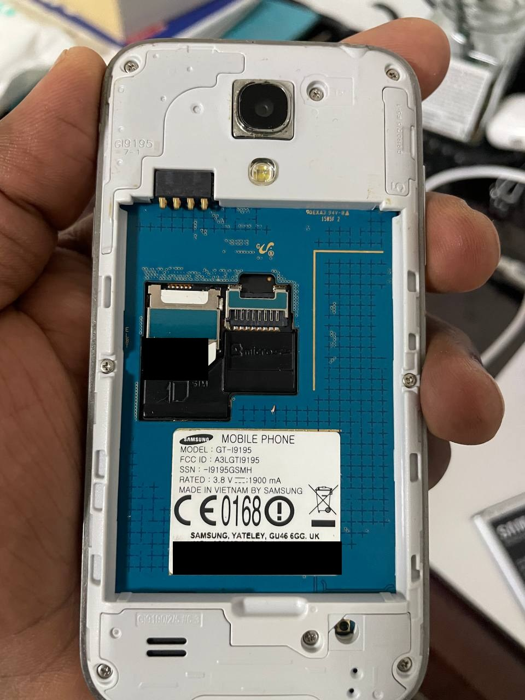
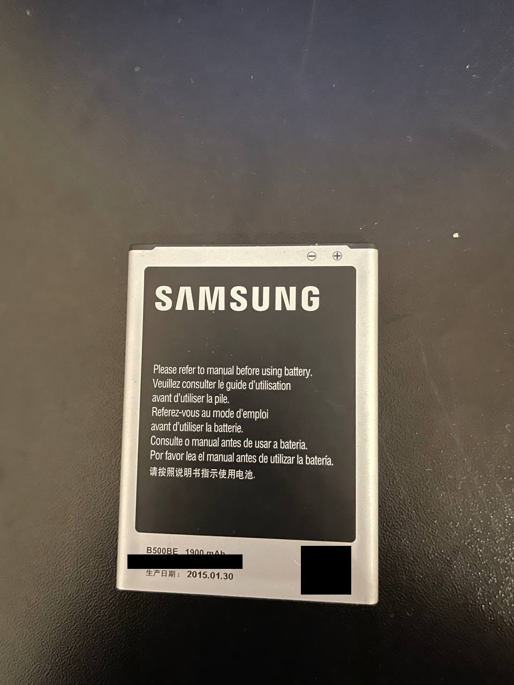
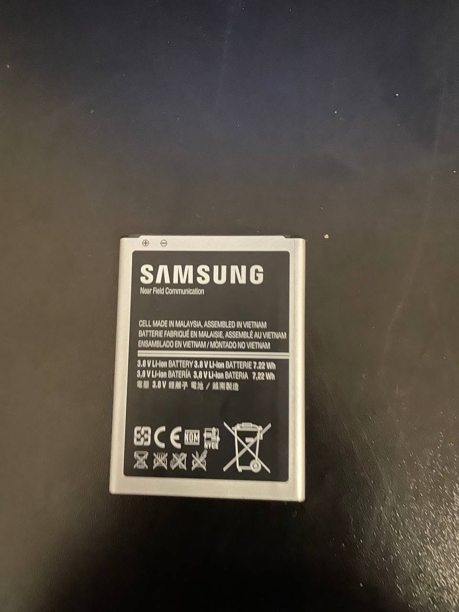
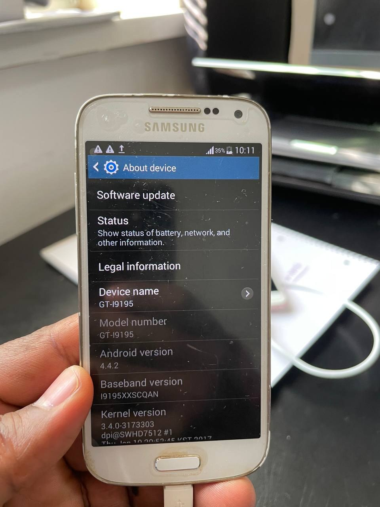
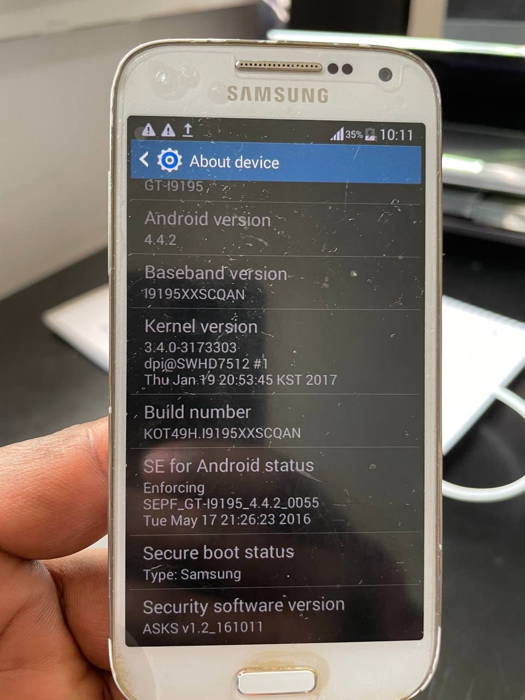
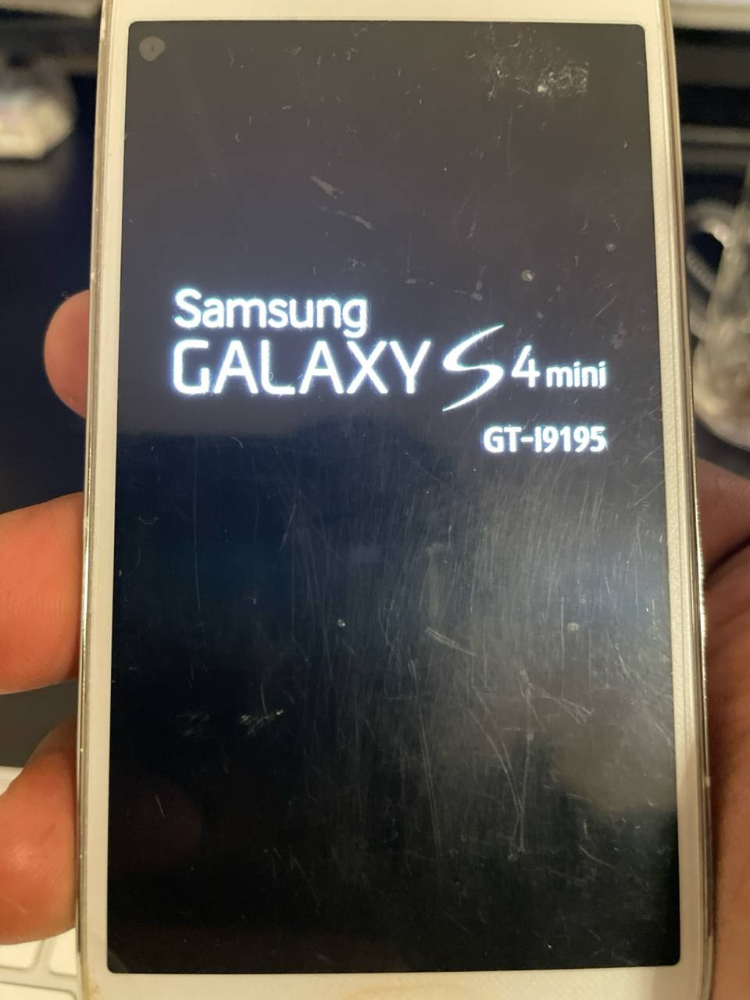
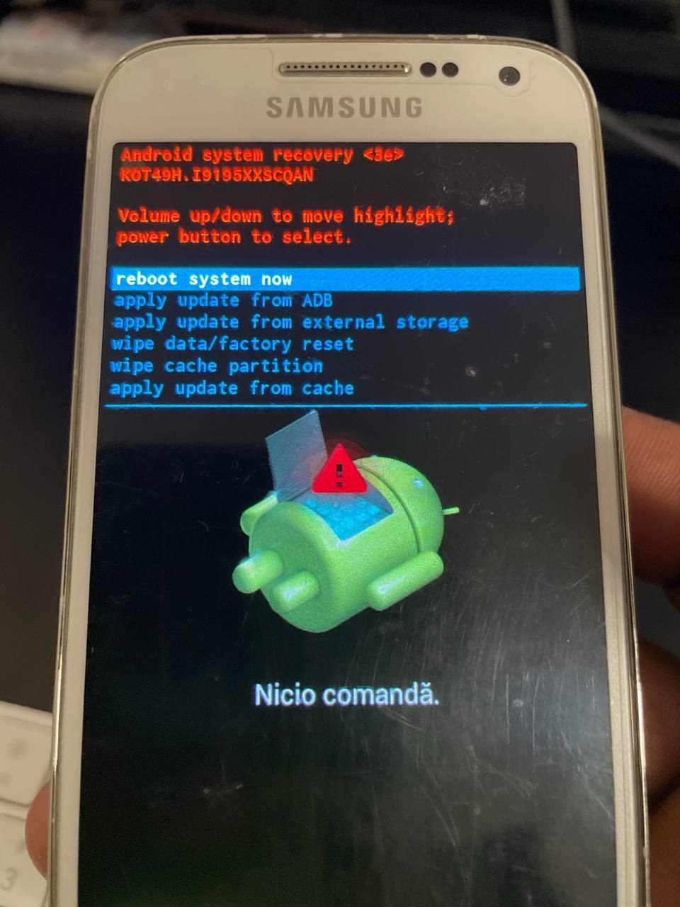
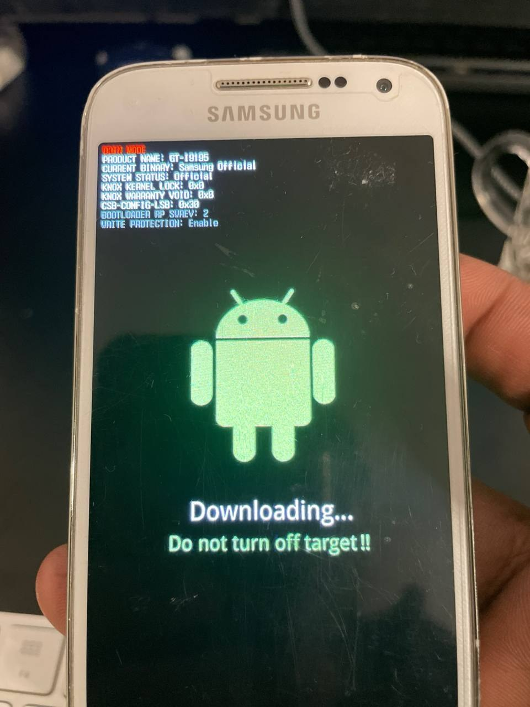

# Phase 0 addendum: owner confirmation, photographs, Ubuntu re-test and firmware re-verification — 2026-11-13

This addendum completes the evidence behind the [Phase 0 closeout](2026-11-13-closeout.md). It records the owner's photographs and confirmation of every physical check, a re-test from the Ubuntu development host, and a repeat of the firmware verification.

**Result: every Phase 0 pass criterion now has a recorded result.** The owner directs that Phase 0 is **PASS** and that its physical checks are not repeated. See [decision](#decision).

**No write to the phone was made.** Phase 2 is not started and no write is authorized by this record.

- **Performed by:** the owner (all physical actions and photographs, accepting the USB-debugging prompt, and the confirmation below) and Claude Code on the Ubuntu development host (read-only commands, firmware checks, this record).
- **When:** 2026-11-13, 15:38 to 16:35 CET. The owner states that the repeated boot, recovery and Download-mode trials were done earlier in November.
- **Checklist:** [hardware verification checklist](../../phase-0/hardware-verification-checklist.md) at `a517f6d`.
- **Tools:** `adb` 1.0.41 (34.0.5-debian), Heimdall v2.1.0.

## How to read this record

| Label | Meaning |
| --- | --- |
| **Measured** | Run on the Ubuntu host on 2026-11-13; the output is linked. |
| **Photographed** | Read from a photograph the owner supplied on 2026-11-13. |
| **Owner-confirmed** | Performed and confirmed by the owner, who performs the physical steps on this device ([AGENTS.md](../../../AGENTS.md#hardware-safety-contract), rule 6) and is responsible for it. No separate log or timing is in the record. |

## Checklist results

| Step | Result | Label |
| --- | --- | --- |
| A1–A4 tools, evidence directory, rules | Done; private evidence kept outside Git | Measured |
| B1 under-battery label | **PASS:** `GT-I9195`, no suffix | Photographed |
| B2 battery | **PASS:** Samsung `B500BE`, 1900 mAh, 3.8 V Li-ion, 7.22 Wh, made 2015-01-30; no damage visible | Photographed + Owner-confirmed |
| B3 charge | 100 % (battery service) | Measured |
| B4 SIM / microSD | Both inserted; microSD size not recorded | Photographed |
| C1 software identity | **PASS:** photograph matches ADB | Photographed + Measured |
| C2 stock cold boot | **PASS: 3 of 3**; times not recorded | Owner-confirmed; boot logo photographed |
| C3–C4 USB debugging; `unauthorized`, then `device` | **PASS** | Measured |
| C5 identity, CPU, memory, partitions | **PASS** | Measured |
| C6 camera sensor types | Rear `S5K3H5XA`, front `S5K6A3YX` | Measured |
| C7 Wi-Fi | **PASS:** joined and reached the internet | Owner-confirmed |
| C8 rear and front photo and video | **PASS** | Owner-confirmed |
| C9 buttons, display, battery service | **PASS** | Owner-confirmed; battery service measured |
| C10 `adb reboot` | **PASS: 3 of 3**, 36.8 to 38.2 s | Measured |
| C11 USB identity, Android | `04e8:6860` | Measured |
| C12 Heimdall negative test in Android | **PASS:** exit 1 | Measured |
| E1 stock recovery | **PASS: 3 of 3**, left with **reboot system now** | Owner-confirmed; menu photographed |
| F1 Download-mode cancel | **PASS: 3 of 3** | Owner-confirmed |
| F2 Download-mode status lines | **PASS:** recorded; no reactivation lock shown | Photographed |
| F3 USB identity, Download mode | `04e8:685d` | Measured |
| F4 Heimdall detection | **PASS:** `Device detected`, exit 0 | Measured |
| F5 PIT read | **PASS:** 28 entries (Windows record, not repeated) | Measured earlier |
| F6 battery exit from Download mode | **PASS: 3 of 3** | Owner-confirmed |
| G1–G4 matching stock firmware | **PASS**, repeated on Ubuntu | Measured |
| H1 same build after the reboots | **PASS** | Measured |
| No write performed | Confirmed | Owner-confirmed + Measured (this session's command list) |
| Write-plan check E-13 | Both recovery-restore files present | Measured |

The owner's statement on 2026-11-13, recorded as given: "I have tested myself three times, like I booted and rebooted and recovered it. It was working", "Camera and Wi-Fi and button is also working", "I have tried Wi-Fi connect, enter the internet normally", and of recovery and Download mode: "It's done long time from November … you don't need to repeat this."

That timing agrees with the phone itself. Before this session's first reboot it had been running for 269,301 s, so it was last started about 2026-11-10 12:56 CET.

## Owner photographs

Originals are kept outside Git. In the copies below, the IMEI, its barcode, the device serial number, the digits printed on the SIM card, and the battery's serial number and 2D code are blacked out.

### Under-battery label (B1)



```text
SAMSUNG   MOBILE PHONE
MODEL : GT-I9195
FCC ID : A3LGTI9195
SSN : -I9195GSMH
RATED : 3,8 V ⎓ ; 1900 mA
MADE IN VIETNAM BY SAMSUNG
CE 0168
SAMSUNG, YATELEY, GU46 6GG. UK
IMEI : <redacted>
S/N : <redacted>
```

The mid-frame moulding above the battery bay reads `GI9195`.

### Battery (B2)




- Front: `SAMSUNG`, model `B500BE`, `1900 mAh`, S/N redacted, production date `2015.01.30`.
- Back: `Near Field Communication`, "Cell made in Malaysia, assembled in Vietnam", `3,8 V Li-ion BATTERY`, `7,22 Wh`.
- The capacity equals the phone label's 1900 mA rating. No bulge, leak or damage is visible in either view, and the owner confirms the battery is in good condition.

### About device (C1)




| Field | Value on the screen |
| --- | --- |
| Device name / Model number | `GT-I9195` / `GT-I9195` |
| Android version | `4.4.2` |
| Baseband version | `I9195XXSCQAN` |
| Kernel version | `3.4.0-3173303`, `dpi@SWHD7512 #1`, `Thu Jan 19 20:53:45 KST 2017` |
| Build number | `KOT49H.I9195XXSCQAN` |
| SE for Android status | `Enforcing`, `SEPF_GT-I9195_4.4.2_0055`, `Tue May 17 21:26:23 2016` |
| Secure boot status | `Type: Samsung` |
| Security software version | `ASKS v1.2_161011` |

These equal the values read over ADB. The phone's clock is wrong (it read 2026-10-08), so the time shown on the status bar does not date the photographs.

### Boot logo (C2)



The stock boot screen reads `Samsung GALAXY S4 mini`, `GT-I9195`.

### Stock recovery (E1)



```text
Android system recovery <3e>
KOT49H.I9195XXSCQAN

Volume up/down to move highlight;
power button to select.

reboot system now            <- highlighted
apply update from ADB
apply update from external storage
wipe data/factory reset
wipe cache partition
apply update from cache

Nicio comandă.
```

The build string equals the installed build. "Nicio comandă" is Romanian for "No command", consistent with the `ROM` CSC.

### Download mode (F2)



```text
ODIN MODE
PRODUCT NAME: GT-I9195
CURRENT BINARY: Samsung Official
SYSTEM STATUS: Official
KNOX KERNEL LOCK: 0x0
KNOX WARRANTY VOID: 0x0
CSB-CONFIG-LSB: 0x30
BOOTLOADER RP SWREV: 2
WRITE PROTECTION: Enable

Downloading...
Do not turn off target!!
```

- **No `REACTIVATION LOCK` line is shown**, so the Phase 0 fail criterion for a reactivation lock does not apply.
- The phone runs official Samsung software, and the Knox warranty bit is not set (`0x0`), agreeing with `ro.boot.warranty_bit=0` over ADB.

Facts for the Phase 2 write plan, recorded without interpretation:

- `BOOTLOADER RP SWREV: 2` is the bootloader's rollback-protection revision.
- `WRITE PROTECTION: Enable`.
- `CSB-CONFIG-LSB: 0x30` is a Qualcomm secure-boot configuration value; its meaning is not established here.
- Whether writing a non-Samsung image to `BOOT` or `RECOVERY` changes `CURRENT BINARY`, `SYSTEM STATUS` or `KNOX WARRANTY VOID` is not known. The write plan must state the expected effect.

While the phone was on this screen, the Ubuntu host measured `04e8:685d` and Heimdall reported `Device detected`, exit 0, at 16:33 CET ([output](2026-11-13-linux/download-mode-usb-detect.txt)).

## Measurements on Ubuntu

All commands were read-only. Four are not named on the checklist's [allowed list](../../phase-0/hardware-verification-checklist.md#allowed) and are recorded as a deviation: `adb get-state`, `adb get-serialno`, `adb shell uptime` and `adb shell date`. Each only reads a value.

- **ADB authorization (C4).** `unauthorized` before the owner accepted the prompt, `device` afterwards ([output](2026-11-13-linux/adb-authorization.txt)).
- **Identity (C5).** `GT-I9195`, `serranolte`, bootloader and baseband `I9195XXSCQAN`, CSC `ROM`, installed CSC `I9195OXXCNK2`, `ro.boot.warranty_bit=0`, `ro.warranty_bit=0`, `ro.secure=1`, `ro.debuggable=0` ([properties](2026-11-13-linux/selected-properties.txt)). Every value equals the Windows record.
- **CPU, memory, kernel (C5).** ARMv7, two processors, implementer `0x51`, part `0x04d`; `MemTotal: 1363632 kB`; kernel `3.4.0-3173303` ([CPU](2026-11-13-linux/cpuinfo.txt), [memory](2026-11-13-linux/meminfo-top.txt), [kernel](2026-11-13-linux/proc-version.txt)). The `Serial` line is removed from the CPU output.
- **Partitions (C5).** The same 24 by-name mappings and partition sizes as the Windows record; `boot` is `mmcblk0p13`, `recovery` is `mmcblk0p14` ([by-name](2026-11-13-linux/by-name.txt), [sizes](2026-11-13-linux/partitions.txt)).
- **Camera sensors (C6).** Rear `S.LSI_S5K3H5XA`, front `SLSI_S5K6A3YX` ([output](2026-11-13-linux/camera-types.txt)).
- **Battery service (C9).** Level 100 of 100, health code 2 (good), 4,354 mV, 27.3 °C ([output](2026-11-13-linux/battery.txt)).
- **USB identity and Heimdall negative test (C11, C12).** `04e8:6860`; `heimdall detect` exits 1 with "Failed to detect compatible download-mode device" ([output](2026-11-13-linux/usb-and-heimdall-android.txt)).
- **Wi-Fi state at measurement time.** `wlan0` was not associated with a network ([output](2026-11-13-linux/wifi-status.txt)), so no ping was sent from Ubuntu. The owner confirms Wi-Fi joins and reaches the internet.

### ADB reboot, 3 of 3 (C10)

`adb reboot` with no argument, run three times from Ubuntu ([output](2026-11-13-linux/adb-reboot-trials.txt)).

| Trial | Start | ADB back | `sys.boot_completed=1` | Fingerprint |
| --- | --- | --- | --- | --- |
| 1 | 15:44:27 | 19.6 s | 38.2 s | unchanged |
| 2 | 15:45:13 | 14.6 s | 36.8 s | unchanged |
| 3 | 15:45:58 | 17.5 s | 38.1 s | unchanged |

Times are from the `adb reboot` command and include the shutdown. These are stock Android diagnostics, not Revival OS boot results.

### Recovery-restore check (write-plan E-13)

```text
$ adb shell ls -l /system/etc/install-recovery.sh /system/recovery-from-boot.p
-r-xr--r-- root     root         1665 2008-08-01 14:00 install-recovery.sh
-rw-r--r-- root     root      2173989 2008-08-01 14:00 recovery-from-boot.p
```

Both files are present ([output](2026-11-13-linux/recovery-restore-check.txt)). By the write-plan draft's own rule for E-13, the plan must assume that **stock Android rewrites `RECOVERY` at boot**. `adb pull` of the script was refused with `Permission denied`; this was recorded and not worked around.

## Firmware re-verified on Ubuntu

The three LFS objects were downloaded from this repository to a private directory outside every repository and checked there. Nothing was flashed.

| Check | Result |
| --- | --- |
| LFS download, size and SHA-256 of all three objects | PASS: equal to [`SHA256SUMS.txt`](../../../firmware/GT-I9195/I9195XXSCQAN_I9195OXXCNK2/SHA256SUMS.txt) |
| ZIP MD5 | `2c6713c2720d8f5ff9a00ce53d61e2ce`, as in the [Windows report](2026-11-13-firmware-rescue.md) |
| ZIP CRC | PASS: all 5 entries |
| Appended MD5 of the BL, AP, CP and CSC packages | PASS: 4 of 4 |
| `boot.img` and `recovery.img` inside the AP package | PASS: byte-identical to the standalone LFS images |
| Header of both images | `ANDROID!`, 2,048-byte pages, header ID equals the recomputed SHA-1 of kernel, ramdisk and second |

Read from the two stock image headers, for the Phase 2 review:

- Kernel address `0x80208000`, tags `0x80200100`, second `0x81100000`; no second stage and no device-tree section.
- Ramdisk address `0x82200000`. The Phase 2 payload uses `0x81200000`; the [research document](../../phase-2/boot-payload-research.md) already notes this difference.
- Command line `console=null androidboot.hardware=qcom user_debug=31`.
- The kernel section is byte-identical in both images (6,699,384 bytes); they differ in the ramdisk.
- Each image ends with 272 bytes after its last page: the 16-byte `SEANDROIDENFORCE` marker, then 256 non-zero bytes. The Phase 2 payload image carries the marker only.

**Limits.** The 256-byte block has the size of an RSA-2048 signature but was **not verified against any key**; no signing-chain verification was done. The differing MD5 on the secondary SamFW listing is still unexplained. These checks show the stored files are intact and are the files Samsung's server delivered. Neither limit is a Phase 0 pass criterion; both belong to the Phase 2 write-plan review.

### Rescue flash: not performed

```text
BLOCKED
Dependency: an approved write plan (AGENTS.md, hardware safety contract, rule 1)
Reason: a rescue flash writes BOOT or RECOVERY. No GitHub write-plan issue naming the
        partition, image, SHA-256, method and rescue procedure has been approved by the
        owner and the orchestrator.
```

The owner offered to try the firmware from this host. Writing a partition is outside Phase 0, so it was not attempted. Rescue execution is part of the Phase 2 write plan.

## Decision

**H3 (owner-directed): PASS.** All Phase 0 pass criteria in the [roadmap](../../../ROADMAP.md#phase-0--samsung-identification-boot-reboot-and-recovery) are met, by measurement, photograph or owner confirmation, as labelled above. The owner directs that the physical checks are not repeated.

This supersedes the closeout's "PASS WITH BLOCKERS (historical evidence gaps)". The gaps it listed are closed above. The firmware limits and the untested rescue flash move to the Phase 2 write plan, where the closeout already placed them.

**H4:** this addendum is submitted on a pull request for orchestrator review. Phase 2 still needs its own approved write-plan issue before any write.

## Safety record

- **Agent commands to the phone:** `adb devices`, `adb get-state`, `adb get-serialno`, `adb shell getprop`, `adb shell cat` of `/proc` and `/sys` files, `adb shell ls`, `adb shell dumpsys battery`, `adb shell ip`, `adb shell uptime`, `adb shell date`, `adb reboot` (three times, no argument), one refused `adb pull`, and `heimdall detect` (once in Android, once in Download mode).
- **Owner actions:** the owner put the phone into stock recovery and Download mode for the photographs.
- **No write:** no flash, wipe, reset, root, unlock or partition write. The PIT was not read again.
- **Kept outside Git:** the serial numbers, IMEI, MAC and IP addresses, the full property list, the kernel command line, the original photographs and the raw outputs, in the private evidence directory for this session.
