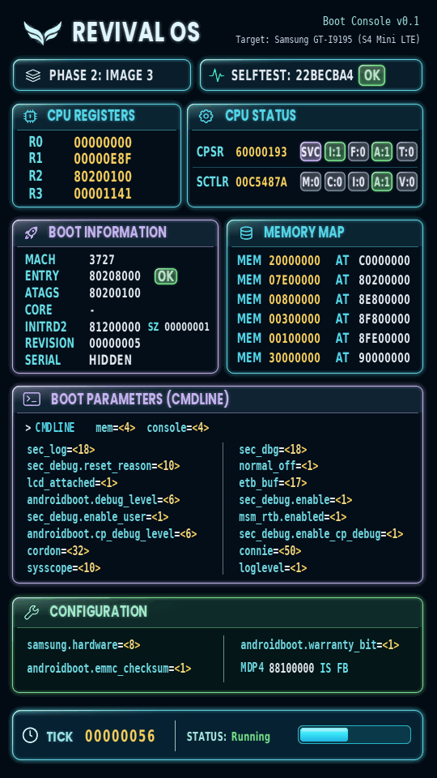

# Phase 2 image 3: the boot screen

**Status: frozen, tested only in QEMU, never written to the phone, and not approved for a write.** The frozen image is `screen.img`, 104,464 bytes, SHA-256 `dc4d81e723c69646208a619d83769deb7859aeb4aa456e9074487d1efdba8d48`; its kernel-slot bytes are `screen.bin`, 98,640 bytes, SHA-256 `fb477f9d52ff949f902e2c2239fd6456c14d5e81db866120b7fd14276e0fe269`. `make check` pins both (test `screen-frozen`); a change to either needs a new review. They were built, tested and reviewed by the implementer in task R-20 ([the report](https://github.com/revival-systems/revival-os/pull/36#issuecomment-7016550824)). A write needs an amendment in the write plan's issue (#28) that names this image's commit, size and SHA-256 ([AGENTS.md](../../AGENTS.md), hardware safety contract, rule 1). Nothing in this document is a hardware result.

The console image ([console-payload.md](console-payload.md)) showed, as white text on black, what the bootloader hands over. It ran on the phone on 2026-11-19 ([session record](../evidence/phase-2/2026-11-19-console-session.md)).

This image shows the same information in the owner's design: panels, colours, smooth letters, the Revival OS mark. It reads what the console image read, and it writes only the kinds of memory the console image wrote: the framebuffer and its own stack. Because the image is larger, its own code and stack reach further up in memory than the console's did ([What it touches](#what-it-touches)). What is new is how it draws.

It is **not** a shell and not a kernel. Nothing can be typed into it. It draws one screen and then counts.

## Labels

| Label | Meaning |
| --- | --- |
| **Measured** | Read from the owner's phone in the sessions of 2026-11-18 and 2026-11-19; the session records hold it. |
| **Source** | Stated in a cited file, or in published code. Not checked on the phone. |
| **Inference** | Our conclusion. No source states it. |
| **Unknown** | Not known for this phone. The entry says what resolves it. |
| **Emulator** | Seen in QEMU by `make test-screen`. Not a hardware result. |

## The screen



This picture is not a photograph. The host oracle (`tests/boot/screen_v3.py`) drew it for the registers and the tag list the phone gave on 2026-11-19, with the counter at 0x56. The values of the command-line words are made up; the screen shows only their names and lengths. `make screen-sample` writes the same picture to `build/boot-serrano-screen/screen-sample.png`, and a unit test fails if the picture here is not the oracle's.

The design is the owner's: a picture of 999 × 1280 pixels. Every position on this screen is the design's own position, mapped onto the 540 × 960 panel. Letters are not squeezed with it; they are made tall and narrow so that they fill the taller panel.

| Part | What it shows | Drawn by |
| --- | --- | --- |
| Header, panel frames, titles, icons, labels | Nothing that is found out. They are one stored picture. | The background |
| `PHASE 2: IMAGE 3` | Which image this is. | The background |
| `SELFTEST: 22BECBA4` and its chip | The image summed its own eight-word table on the phone. The chip is green `OK` when the sum is the expected one, red `BAD` when it is not. | The image |
| CPU REGISTERS | r0 to r3 as the bootloader left them. | The image |
| CPU STATUS | CPSR and SCTLR. After CPSR: the mode by name, then the IRQ mask, the FIQ mask, the abort mask and the Thumb bit. After SCTLR: MMU, data cache, instruction cache, alignment checking, high vectors. A chip is green with `1` when its bit is set and grey with `0` when it is not. | The image |
| BOOT INFORMATION | `MACH`: r1 in decimal. `ENTRY`: the address the image was entered at; the `OK` chip is drawn only when that is the address it is linked for. `ATAGS`: r2. Then the tag list's first `CORE` tag (its page size, or `-` if it carries none), the first `INITRD2` tag (start, and `SZ` size), the first `REVISION` tag, and `HIDDEN` if a serial tag is present. A row stays empty if the list has no such tag. | The image |
| MEMORY MAP | The first six memory tags: size, `AT`, start. | The image |
| BOOT PARAMETERS (CMDLINE) | The kernel command line: for each word its name and the **length** of its value, `name=<length>`, or `<length>` alone for a word with no `=`. | The image |
| CONFIGURATION | The command-line words that come after the columns are full, up to three, and `MDP4`: the display controller's framebuffer-address register, with `IS FB` if it names the buffer the image draws in and a red `NOT FB` if it does not. | The image |
| `TICK` | A counter that goes up by one after every 4,194,304 turns of a wait loop, for as long as the phone is on. | The image |
| `STATUS:` | `Reading` while the display register has not been read. `Running` once the image is counting. | The image |
| The bar | One piece, as the design draws it, filled as far as the counter's last four bits say: a sixteenth more at each step, and after the full bar from one sixteenth again. It is there so that a step can be seen from further away than a digit can be read. **It is not a progress bar.** The image has nothing to be part-way through, and no number stands beside it. | The image |

The design picture had `STATUS: Booting…`, a bar filled to 68% and that number beside it. Nothing in this image is 68% done, so the screen has neither the word nor the number (reviewer's ruling on the design, 2026-11-19). The bar itself is the design's: one piece, with its gloss. A bar that fills can be read as progress even with no number beside it, which is why the implementer's review proposed sixteen separate cells; the owner chose the design's bar (2026-11-19), and this table says what its length means.

The chips, the bar and the corner of each panel where its title stands have the design's gel look: a soft glow, a rim that is brightest at the top left, a gloss over the upper part. None of that is computed on the phone; it is in the stored pictures.

### The command line

The words keep the order the bootloader gave them. Nothing is picked out and nothing is sorted:

1. the first two words go on the line that starts `> CMDLINE`;
2. the next words fill the two columns, row by row, left then right;
3. when the columns are full, up to three more go into the CONFIGURATION panel: left, left below, right.

So what the CONFIGURATION panel holds depends on the number of words. With 21 words it holds the last three, as the design has it; with 22 the columns have grown a row and it holds the last two; with 18 or fewer it holds none.

The columns have eight rows, which with the other places holds 21 words. That is the number the console image showed on 2026-11-19 (**Measured**: 21 words were on its screen; whether the list has more is **Unknown**, because the console's screen was full). A list with more words gets nine or ten rows, closer together, which holds up to 25. Ten rows is the limit: closer than that, the letters of one row would run into the next.

A word longer than its place is cut, and its last character is then `~`. **A word that has a place is always drawn**, at least as its first characters and a `~`. On the head line the first word may take at most 46 of the 56 characters, so that after it and two spaces the second word still has eight.

### When something is wrong or missing

| What appears | Where | Meaning |
| --- | --- | --- |
| A red chip with one word | The right-hand end of the BOOT INFORMATION title | Why the tag list was not read, or not read to a proper end. `OUT`: r2 does not point into the tag page. `ODD`: r2 is not a multiple of four. `DTB`: a device tree is there, not a tag list. `SIZE`: a tag claims a size of 1 word, or of more than 2,048. `PAST`: a tag would run past the end of the tag page. `MANY`: more than 64 tags. `KIND`: the tag that ends the list has a kind other than 0. With `OUT`, `ODD` and `DTB` nothing is read. With the other four, the tags before the fault are shown. |
| `NOT SHOWN: n TAGS m WORDS`, in red | The right-hand end of the BOOT PARAMETERS title | The list holds things this screen has no place for. Tags: a kind with no place here, or one more of a kind than there are places (a seventh memory tag, a second `CORE`). Words: command-line words past the twenty-fifth. Either part is left out when its number is 0. |
| `CMDLINE UNTERMINATED`, in red | The right-hand end of the CONFIGURATION title | A command-line tag's text has no terminating zero byte: it was cut off at the end of its tag. |
| An empty `MDP4` value, `STATUS: Reading`, no counter | | The read of the display register did not come back. |
| Stripes | The whole panel | The image was entered at another address than it is linked for; see below. |

When none of these appears, the whole list is on the screen and it ended properly.

This screen shows less of a strange tag list than the console image does. The console prints one line for each tag, known or not; this screen counts the tags it has no place for. For a list that needs reading tag by tag, the console image is the tool.

## What it never shows

The same as the console image, by the same means. A photograph of this screen is evidence, and evidence gets shared; the repository's rule 7 forbids serial numbers and other identifiers. The tag list is read by the console image's own `atags.rs`, used unchanged, which gives the rest of the image a word's name and the length of its value and never a byte of the value. So this image **cannot** draw:

- **Command-line values**, and words with no `=`: only their lengths.
- **The serial tag's words**: only the fact that the tag is there.
- **Tags of unknown kinds**: they are only counted.
- **A device tree**: only the fact that it is one.

What is drawn: register values, addresses and sizes of memory regions, the board revision, and the names of command-line words. A byte of a name that is not printable ASCII is drawn as `?`.

## What it touches

| | What | Notes |
| --- | --- | --- |
| Writes | The framebuffer, 0x88100000 to 0x8827BB00 | Every write goes through one routine that checks the address against the buffer's size. |
| Writes | Its own stack, the 64 KiB after the image | As the console image; this image also keeps one row of the background there while it unpacks it (1,024 bytes). |
| Reads | The seven words `kstart.S` captured | On that stack. |
| Reads | Its own code, constants and stored pictures | |
| Reads | The tag page, 0x80200000 to 0x80208000 | Only if r2 is inside it and a multiple of 4; only whole words; never past its end. Read twice: once to count the command line's words, once to draw. |
| Reads | One register, 0x05190008 (MDP4 `DMA_P` buffer address) | Once, after everything else is on the screen. **Measured:** both earlier images read it on the phone; it returned 0x88100000 and did not hang. Never written. |

It writes nothing else: no peripheral register and no other memory. It uses no storage and does not reset the phone. **It never reads the framebuffer.** It changes no processor setting: the caches and the MMU stay off, as the bootloader leaves them. Under rule 1's standing approval it is therefore a "further test image", not an image that "does something new to the hardware" (reviewer's reading; the amendment in the issue will state it).

No heap, no allocator, no interrupts, no timer, no watchdog, no `svc`, no `core::fmt`, and no code path that can panic.

| Region | Range | Source |
| --- | --- | --- |
| Tag page | 0x80200000 to 0x80208000 | **Source:** boot-image parameters. **Measured:** r2 = 0x80200100. |
| Image and its 64 KiB stack | The frozen image is at 0x80208000 to 0x80220150, and its stack is the 64 KiB above it, up to 0x80230150 (the console image's stack top was 0x802198F0). The image may be at most 128 KiB, and `link.ld` allows at most 16 MiB (to 0x81208000). | `boot/samsung-serranolte/link.ld`; the addresses are from the linked file (task R-20). **Measured:** entry at 0x80208000; the bootloader lists this memory as RAM (`MEM 07E00000 AT 80200000`, 2026-11-19). |
| Framebuffer | 0x88100000 to 0x8827BB00 (1,555,200 bytes) | **Measured:** the buffer the panel shows starts at 0x88100000. Its size follows from the panel geometry, which is **Source**. |

The three do not overlap. The image is about fifteen times the size of the console image, so it and its stack use 92,256 bytes of memory above where the console image's stack ended. That memory is ordinary RAM, far inside the region where the bootloader loads an Android kernel of several megabytes (**Inference**). In QEMU the stack in use while counting was 332 bytes; from the frame sizes the deepest use is about 1.4 KiB of the 64 (task R-20).

## How it is built

| File | What it is |
| --- | --- |
| `boot/samsung-serranolte/kstart.S`, `link.ld` | **The first image's files, unchanged.** Everything that runs before Rust is the code that has already run on the phone. |
| `console/atags.rs`, `console/board.rs` | **The console image's files, unchanged**, used from where they are: the tag-list reader, and every address and size with its evidence label. |
| `screen/main.rs` | The entry `payload_main`: which value goes where, the command line's layout, the counter. |
| `screen/gfx.rs` | The framebuffer and the four ways of drawing on it. The only code that writes to the screen. It does not know the board. |
| `screen/assets.bin` | The stored pictures: 81,144 bytes. |
| `screen/assets.rs` | Where each picture is in `assets.bin`, every position and every colour, as Rust constants. Generated. |
| `screen/assets.json` | The same facts for the host oracle. Generated. |
| `screen/art.png`, `art.json` | The Revival OS mark and the nine icons, cut from the owner's design picture, and where each was cut from. Input to the generator. |
| `tools/gen_boot_screen.py` | The generator: draws the background, the letters and the small shapes on the build machine and writes the three `assets` files. |

Nothing under `boot/samsung-serranolte/console/` is changed: the console image stays frozen at its bytes, and `make check` still checks that.

**The generator is not part of the build.** `assets.bin`, `assets.rs` and `assets.json` are committed, and a build only reads them. The generator needs Pillow and four font files, and what it draws depends on their versions, so it would not give the same bytes on every machine. `assets.json` records which Pillow drew the pictures and the SHA-256 of each font file and of `art.png`. The generator is run by hand to change the design, and its three output files are committed together. A unit test fails if the three disagree with each other.

The icons were cut out of the design picture as brightness, so each brought a little of what was around it: a piece of its panel's border as a line above it, and a haze. The generator takes both off before it draws an icon; `art.png` itself is kept as it was cut.

**Fonts.** The letters in the stored pictures were drawn from DejaVu Sans Mono, DejaVu Sans Condensed (version 2.37) and Poppins (version 4.004). The repository holds pictures of letters, not the font files. The fonts' licences are in [docs/licenses/](../licenses/README.md).

`make screen` builds `build/boot-serrano-screen/screen.bin` (the kernel-slot bytes) and `screen.img` (the Android boot image around them, packed by `tools/pack_bootimg.py` as the other two images are). The directory is its own, so that the write plan's host check keeps finding one image in each directory.

## The stored pictures

Everything the phone draws is a copy of something stored. It computes no shape, no blur, no glow and no letter.

**Colour pictures.** The background is the whole screen with everything that never changes on it. Each chip, with its letters, is a small picture of its own, one for each thing a chip can say: ten for the processor mode, two for each of seven bits, seven red ones for a tag list that fails, `OK` in two sizes and `BAD`. The inside of the bar is sixteen pictures, one for each length. That is 50 small pictures.

A colour picture is stored as one colour number for each pixel, with a palette of up to 256 colours, and packed: most pixels are equal to the pixel above them or to their left neighbour. The packed form is a run of operations, each one byte with its kind in the top two bits and a number n in the low six:

| Kind | Bytes | Meaning |
| --- | --- | --- |
| `00` | `n` | The next n+1 pixels equal the pixel one row up. |
| `01` | `n`, `c` | The next n+1 pixels have colour number c. |
| `10` | `n`, then n+1 bytes | The next n+1 pixels have the colour numbers that follow. |
| `11` | `n`, `m` | The next n×256+m+1 pixels equal the pixel one row up. |

Above a picture's first row every pixel counts as colour number 0. The background has a palette of its own and takes 33,120 bytes for its 518,400 pixels. The small pictures share a second palette; the chips take 21,817 bytes and the bar's sixteen pictures 3,253.

In the small pictures colour number 0 means "no pixel here": the image leaves such a pixel as it is. A chip's corners are such pixels, and so are the corners of the bar's inside. A chip's soft edge and glow were laid over the flat colour of the place it goes when the picture was made, so the image only copies. The sixteen pictures of the bar draw exactly the same pixels, filled or dark, so the one drawn last is all that shows; a unit test checks that.

**Letters and a few words** are masks: for each pixel a coverage level from 0 to 15, four bits, two pixels a byte. A mask is drawn in one colour over a background whose colour the image knows:

```text
result = (background × (15 − level) + colour × level + 7) / 15      for each of red, green, blue
```

A level of 0 draws nothing. That is what makes the letters smooth, and it needs no read of the framebuffer: every value is drawn in a place where the background is one flat colour, and `assets.rs` says which. The gloss on a panel's title has faded out before the places where the image writes. A unit test draws four screens and fails if any letter, chip or cleared box lands on a pixel of another colour than the one it was made for.

There are six sets of letters (five of digits for the different rows, one of all 95 printable characters for the command line) and six whole words (`HIDDEN`, `MEM`, `AT`, `SZ`, `Reading`, `Running`).

A text is placed with a pen that moves in sixteenths of a pixel; each letter is drawn at the pen's whole pixel. In every set each letter has the same width, and that width is a whole number of pixels, so every gap between two letters is the same. (The design's own spacing is not: at 7.3 pixels a letter, every third or fourth gap came out a pixel wider, and `sysscope` read as `syss cope`. The spacing is the design's, moved to the nearest whole pixel.)

## Design decisions

**Stored pictures, not computed ones.** The implementer's design notes said that smooth letters and glow could not be had in an image of this kind. They can, if they are stored and not computed: the cost is size, about 100 KiB where the console image is 6. The limit for this image is 128 KiB; a test fails above it.

**The background first, from the top.** The image's first write is the top-left pixel of the background and it goes on row by row. So the bootloader's picture is replaced from the top down, and a photograph of a screen that stopped early shows how far it got. The values are drawn after the whole background.

**How long it takes to draw is Unknown.** The caches are off, so every instruction is fetched from memory, and every load and store is a memory access. From the disassembly of the frozen build, the implementer counted about 31 million instructions for the whole screen, against 21 million for one counter step of this image (task R-20). So the screen should take about as long to appear as one and a half counter steps take. One step of the console image took under 14 seconds on 2026-11-19 by the reviewer's reading of that session, which is a bound and not a measurement. The screen may appear at once or wipe down over some seconds. The session's video gives the time; it is this image's one new measurement.

The background is slower here than it was in the first build: 51 instructions for a pixel in the common case, where the first build took 36. The cause is that the background now goes through the same routine as the small pictures, which tests every pixel for a hole and for the panel's right edge and keeps more of its numbers on the stack. If the session shows a slow draw, the cheapest cure is a path of its own for the background; beyond that there are cheaper ways to write the pixels (task R-19 lists three), and then the instruction cache, which is a change to the processor's state and belongs to a later image with its own approval.

**The order of risk.** Everything that only reads memory comes first. The status word is set to `Reading`, then the one register is read, then its value, `Running` and the counter are drawn. A hang or fault at the read leaves the whole screen without those.

**`Running` means the image reached its counting loop**, no more. The bar and the counter are what show that it still runs.

**Faults.** As in the earlier images, every exception vector is `kstart.S`'s halt. A fault draws nothing and stops; what was drawn stays.

**No panic.** The image contains no panic code at all, which a test checks in the linked file. Lookups are checked, nothing is divided by a number that is not a constant, and nothing is indexed with a number that could be out of range.

**If the image is loaded somewhere else.** The image is linked for 0x80208000 and reaches its stored pictures through absolute addresses. Entered anywhere else it draws the console image's 20 white and black stripes, which need nothing stored, and stops. **Measured:** the phone entered both earlier images at 0x80208000, so stripes are not expected.

**The counter.** Each digit has its own cell. A cell is cleared and its digit drawn; at a step only the digits that changed are redrawn, and the inside of the bar. The wait between two steps is the console image's loop in source, with the same number of turns. It is not the same length: built at level 2, one turn is five instructions here, where the console image's (level z) is six (the implementer's disassembly, task R-19). So a step here should be somewhat shorter than the console's, and the bound from the console session does not carry over exactly.

**Alignment.** As the console image: the bootloader hands over with alignment checking on and the MMU off, so the image must make no unaligned word access. It reads words only from the tag page, at addresses it has checked, and the Rust target never generates an unaligned access. The QEMU tests run it in that state, after showing that the QEMU in use faults an unaligned load there.

**Optimisation level 2.** The console image was built for size (level z) to stay under 8 KiB. This image's size is its pictures, and on the phone fewer instructions is what makes it draw sooner. `make screen-sizes` prints the size at levels 2, s and z.

## Tests

`make test-screen` (part of `make check`). Everything here is **Emulator** evidence or a build check. The host oracle is `tests/boot/screen_v3.py`; the QEMU harness is `tests/boot/run_screen.py`, which is the console image's harness with this oracle; the unit tests are `tests/boot/test_screen_v3.py` (run by `make test-unit`).

The oracle and the image share data, not code. Both read `assets.bin`, and the positions and colours come from the same generator run (`assets.json` for the oracle, `assets.rs` for the image; a unit test compares the two). What is drawn where, and from which value, is written twice: in Rust in the image and in Python in the oracle. Before each run the harness fills the framebuffer with the byte 0x55. No pixel of an expected screen has that value in all three of its bytes (each case checks that), so a dump that equals the oracle shows that the image wrote every pixel of the panel.

**A wrong image can still pass these tests in three ways** (the implementer's review, task R-19):

- **Shared data.** A picture that is wrong or in the wrong place is wrong in the image and in the oracle alike, because both come from one generator run. Only looking at the screen finds that: the picture above, and then the phone.
- **A misreading both writers share.** The two readers of the tag list are separate programs, but one person wrote both descriptions of what goes where.
- **What the harness does not look at:** memory other than the tag page, the framebuffer and 64 KiB on each side of it; a write to a peripheral (QEMU's board has other devices at those addresses); and the `Reading` state, which the image passes through and never rests in. For these the evidence is the source and the disassembly: one routine writes the framebuffer, and the only other addresses the code forms are the one register it reads and its own image and the tag page (task R-19, review points 1 and 2).

| Test | What it can show |
| --- | --- |
| `unit-python` (`test_screen_v3.py`) | The three `assets` files describe the same pictures, which fill `assets.bin` with no gap. The background is exactly one screen. The fonts the layout counts characters in are fixed-pitch, in whole pixels; the counter's cells do not overlap; every word a chip can carry fits its chip; every place for a command-line word stays inside its panel. Every value is drawn on the background colour the image assumes. The rule for placing words, and that the head line's second word is drawn whatever the first is. Each fault of a tag list has its own mark. Each name the image has for a chip leads to the picture the oracle's name leads to. The bar's sixteen pictures replace one another, each longer than the one before. Replacing every hidden value changes no byte of the screen. The picture in this document is the oracle's. |
| `screen-size` | The flat image is within 131,072 bytes. |
| `screen-no-system-calls`, `screen-symbols`, `screen-elf-attributes` | As for the other images: no `svc`, nothing undefined, ARMv7-A soft-float. |
| `screen-no-panic-code` | The linked image has no `core::panicking` and no `core::fmt` symbol. |
| `screen-corrupt-image-rejected`, `screen-image-unchanged` | A one-byte change is caught by the SHA-256. |
| `screen-host-tests` | `gfx.rs` itself, on the build machine (`tests/boot/screen_host.rs`), built without optimisation so that arithmetic overflow is checked, against memory with guard bytes on both sides. It is given what the image never gives it: rectangles, masks and pictures far outside the panel, a picture cut short at every byte, a palette that is too small, a font or a picture that points outside the stored pictures. It never writes a guard byte or a row's padding. |
| `screen-vector-header` | The image starts with `kstart.S`'s vectors and zImage words, and holds `assets.bin` byte for byte. |
| `qemu-screen` | With no handoff, the whole screen is byte-exact. The counter's digits and its bar are then watched, byte-exact at every look, until the counter has passed 0x10, so a carry into the next digit has been drawn and the bar has gone from full back to one sixteenth. Then the whole screen is byte-exact again. |
| `qemu-screen-selftest-bad` | The self-test can fail. In a copy of the image, one bit of the table it sums is flipped: the screen shows the sum of the changed table and the red `BAD` chip, byte-exact, and the image still runs. |
| `qemu-screen-device-handoff` | Entered as the phone enters it, with a sample tag list and the register reading 0x88100000: byte-exact, and byte-identical to the oracle's screen for the same list with every hidden value replaced; the tag page is unchanged. |
| `qemu-screen-phone-list` | The registers and the tag list recorded on 2026-11-19, with made-up command-line values: byte-exact. This is the screen in the picture above, except for CPSR and SCTLR, which are QEMU's. |
| `qemu-screen-alignment-control` | In the phone's state (alignment checking on, MMU off) this QEMU faults a word load from an odd address, and the same load from an aligned address works. |
| `qemu-screen-alignment-checked` | The device handoff with alignment checking on, as on the phone: byte-exact, no fault. |
| `qemu-screen-tag-lists` | The console image's twenty-one malformed and edge-case tag lists, and thirteen more that only this screen can get wrong: 21, 22, 25, 26 and 200 command-line words; a first word far longer than the head line; words exactly as long as their places, and one character longer; seven memory tags; every kind twice; two command-line tags; a command line with no terminating zero after thirty words. One run each, alignment checking on: byte-exact, no fault. |
| `qemu-screen-noise` | Four tag pages of pseudo-random bytes: byte-exact, no fault, and the walk stays inside the page. |
| `qemu-screen-moved` | Loaded and started at another address: the stripes, then a halt, no fault. |
| `qemu-screen-fault-halts` | With memory that ends inside the framebuffer, the background's write past its end faults, the processor rests in the halt loop in abort mode, and everything drawn before is byte-exact. |
| `screen-bootimg-valid` | An independent reader accepts every field of `screen.img`. |
| `screen-repro-identical` | Two clean builds give identical bytes. |
| `screen-frozen` | Not a test yet: it prints the two hashes. Once they are pinned it fails if either changes. |

After every QEMU run the harness also checks that the tag page still holds exactly what was stored and that 64 KiB on each side of the framebuffer were not written.

What the emulator cannot show: the panel, its colours, how long anything takes, what the bootloader passes, and whether the register read behaves again as it did. Those are what a session is for.

## Changes after the first build

The first version of this image was built and tested by the implementer on 2026-11-19 (task R-19, [the report](https://github.com/revival-systems/revival-os/pull/36#issuecomment-7014327202)): it compiled as written, every test passed, and the review found no safety defect. That version was never written to the phone. What is drawn was changed after it:

| Change | Why |
| --- | --- |
| The head line's first word is limited, so that the second always has room. | The report: a first word of 52 characters or more left the second one out with no mark, against this document's own rule. It could not happen with the phone's recorded list. |
| Letters step a whole number of pixels. | The report: uneven gaps. `sysscope` read as `syss cope`, a risk when a photograph is typed out. |
| The icons are cleaned of the piece of border and the haze that came with them. | The report: a thin stray line showed above each panel's icon. |
| The chips, the bar and the corner of each panel's title have the design's gel look. The chips and the bar became stored colour pictures for that; before, they were flat shapes with letters drawn on them. | The owner, 2026-11-19, from two close-ups of the design. |
| The red chip for a failed tag list moved from beside the `ATAGS` value to the end of the panel's title. | With its glow it no longer fitted between the rows. |

The reviewer had also replaced the bar by sixteen cells with one lit, as the report proposed. That version was not built: the owner asked for the design's one-piece bar, and it is back.

The self-test's failing case was added to the QEMU tests, and three sentences of this document that the report showed to be wrong were corrected.

The version with all of this was built, tested and reviewed by the implementer on 2026-11-19 (task R-20, [the report](https://github.com/revival-systems/revival-os/pull/36#issuecomment-7016550824)): it compiled as written, 126 PASS lines with the hashes pinned, and nothing the review found would block a write. It is the frozen image.

## Known weaknesses, accepted for this image

From the R-20 review. None changes what the image touches; each would change its bytes, so each waits for the next image.

| Weakness | Why it is accepted |
| --- | --- |
| The red `BAD` chip is the hardest thing on the screen to read: its word nearly fills the chip, pale pink on dark red. | It appears only if the self-test fails. Then the chip is red where it is otherwise green, and the sum beside it is not `22BECBA4`; neither needs the word to be read. |
| The background takes 51 instructions a pixel where it could take 36. | How long the screen takes is not known at all yet. The session measures it first. |
| The gloss on the title corners is faint and will probably not show in a photograph. | Cosmetic. |
| The bar fills, and a bar that fills can be read as progress. | The owner's choice; the screen has no percentage, and this document says what the length means. |

## What is not known

| Question | Label | What resolves it |
| --- | --- | --- |
| How long the screen takes to draw | **Unknown** | A session's video. |
| Whether the colours on the panel are the design's | **Inference** that they are: the byte order blue, green, red is **Measured**, but only blue, white and black have been seen on this panel | A photograph of this screen. A phone photograph does not show colours exactly. |
| Whether the small letters can be read on the panel and in a photograph | **Unknown**: the command line's letters are 7 pixels wide; its small letters are about 9 pixels high and its digits about 12, roughly 1 mm on the panel and a third of the console image's. They cannot be larger and still fit the design's two columns: the phone's longest word takes 30 characters. | An original close photograph of this screen. A compressed copy will probably not do. |
| Whether the command line has more than 21 words | **Unknown** | This screen: all words are shown, or a red note says how many are not. |
| How long one counter step takes | **Unknown** (a bound only) | A session's video. |

## Not in this image

No input, no scrolling, no second page, no fault report, no timer, no interrupts, no caches. Each comes when a milestone needs it ([ROADMAP.md](../../ROADMAP.md)).
